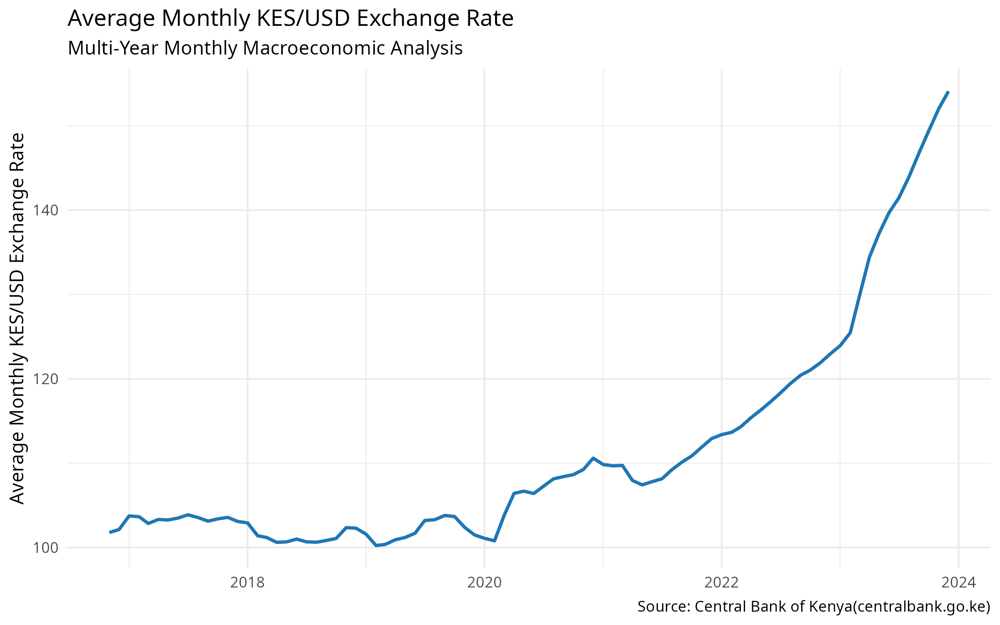
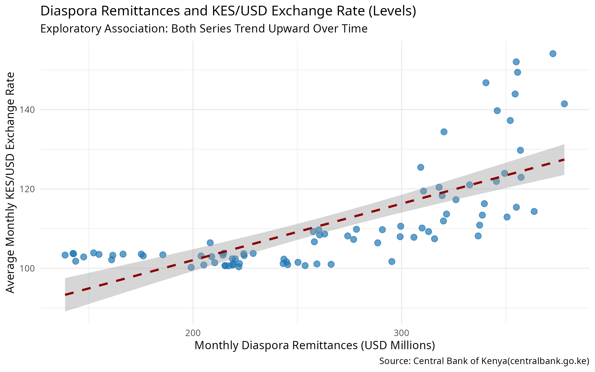
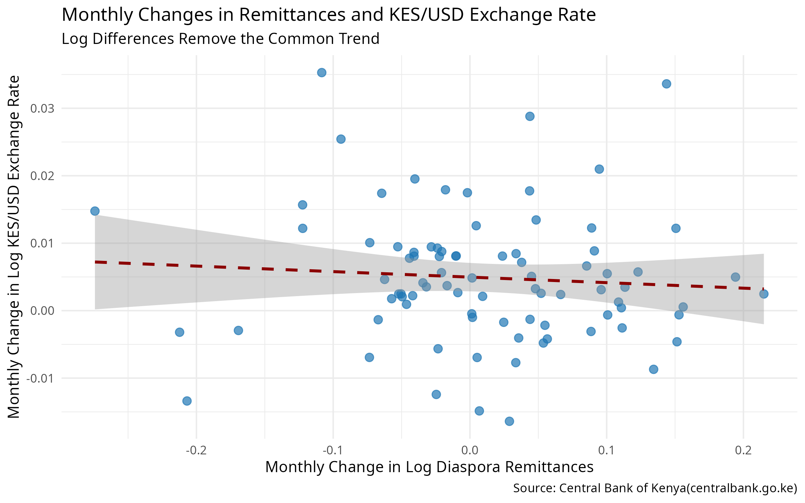
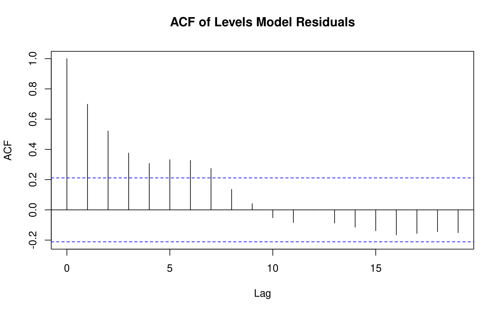

# KES/USD Macro-Econometric Analysis

An end-to-end R project that cleans Central Bank of Kenya (CBK) data and tests whether diaspora remittances and the Central Bank Rate (CBR) explain movements in the Kenya shilling–US dollar exchange rate (November 2016 – December 2023).

**Author:** Isutsa Russell

------------------------------------------------------------------------

## Overview

The project has two parts:

1.  **Data pipeline:** imports three raw CBK datasets, standardises mixed date formats, removes duplicates, aligns everything to a monthly frequency and merges it into one modelling-ready table.
2.  **Econometric analysis:** fits an OLS model in levels, diagnoses it for spurious regression, and re-estimates it in log differences with Newey-West robust standard errors. \## Key Findings

| Model                       | R²   | Remittances | CBR        | Durbin-Watson |
|-----------------------------|------|-------------|------------|---------------|
| Levels (exploratory)        | 0.79 | p \< 0.001  | p \< 0.001 | 0.60          |
| Log differences (preferred) | 0.04 | p = 0.30    | p = 0.25   | 0.90          |

- The levels regression looks strong, but the exchange rate, remittances and CBR are all non-stationary and the residuals are heavily autocorrelated, which are the classic signs of spurious regression.
- Once the shared trend is removed by differencing, neither remittance growth nor changes in the CBR is a statistically significant predictor of monthly exchange-rate changes.
- The shilling depreciated by about 51% over the sample (KES 101.8 to KES 154.1 per USD). The results describe an association in trending data and do not establish causality. The full write-up is in the [project report](report/kes_usd_macro_econometric_analysis_report.md) ([PDF version](report/KES%20USD%20Macro-Econometric%20Analysis%20Report.pdf)).



## Figures

**Levels relationship (exploratory).** Both series trend upward, so the fitted line should not be read as evidence of a relationship.



**Monthly changes (after differencing).** Once the shared trend is removed, the fitted line is almost flat.



**Residual autocorrelation (levels model).** Strong autocorrelation at early lags is a sign of spurious regression.



## Data

All data are from the [Central Bank of Kenya](https://www.centralbank.go.ke). Place the raw files in `data/raw/` before running the scripts.

| File | Description | Frequency |
|----|----|----|
| `historical_data.csv` | Daily exchange rates for multiple currencies (USD series used) | Daily |
| `Diaspora Remittances.csv` | Total diaspora remittances in USD thousands | Monthly |
| `Central Bank Rate (CBR) .csv` | Policy rate announcements | On announcement |

**Analysis window:** November 2016 – December 2023 (86 monthly observations). The window is set by the USD exchange-rate series, which starts mid-October 2016 and ends in early January 2024, so partial months at either end are excluded.

## Project Structure

```         
.
├── data/
│   ├── raw/                    # Original CBK files (not modified)
│   │   ├── historical_data.csv
│   │   ├── Diaspora Remittances.csv
│   │   └── Central Bank Rate (CBR) .csv
│   └── processed/              # Created by 01_data_cleaning.R
│       ├── master_monthly_fx.csv
│       └── usd_daily_clean.csv
├── outputs/
│   └── figures/                # Created by 02_modeling.R
│       ├── exchange_rate_trend.png
│       ├── remittances_vs_exchange_rate.png
│       ├── remittances_vs_exchange_rate_changes.png
│       └── levels_residual_acf.png
├── report/                     # Written report
│   ├── kes_usd_macro_econometric_analysis_report.md
│   └── KES USD Macro-Econometric Analysis Report.pdf
├── R/
│   ├── 01_data_cleaning.R
│   └── 02_modeling.R
└── README.md
```

## Getting Started

### Requirements

- R 4.1 or later (the scripts use the native pipe `|>`)
- The following packages:

``` r
install.packages(c(
  "tidyverse", "lubridate", "janitor",   # data wrangling
  "lmtest", "tseries", "sandwich", "car" # modelling and diagnostics
))
```

### Running the analysis

All file paths in the scripts are relative to the **project root**, so the working directory must be the root folder (the one containing `data/`, `R/` and `outputs/`). In RStudio, the easiest way is to create a project from the existing folder (File → New Project → Existing Directory), which sets the working directory automatically. Then run the scripts in order:

``` r
source("R/01_data_cleaning.R")   # cleans and merges the raw data
source("R/02_modeling.R")        # fits models, prints diagnostics, saves figures
```

## Methodology

**Data cleaning (`01_data_cleaning.R`)**

- Reads all files as text and parses types explicitly, which avoids problems with thousands separators and file encoding.

- Parses two date formats (`yyyy-mm-dd` and `dd/mm/yyyy`) found in the exchange-rate file and filters to the US dollar series.

- Removes duplicate daily records and keeps complete months only.

- Converts remittances from USD thousands to USD millions.

- Builds a complete monthly CBR series, carrying the rate in force forward through months without an announcement, so no observations are lost to missing values.

- Checks for duplicate months and missing values before exporting. **Modelling (`02_modeling.R`)**

- OLS of the average monthly exchange rate on remittances and the CBR (levels).

- Residual diagnostics: Durbin-Watson test, ACF plot and variance inflation factors.

- Augmented Dickey-Fuller tests on each series in levels and first differences.

- OLS of monthly log exchange-rate changes on remittance log changes and CBR changes, with Newey-West standard errors. \## Outputs

| File | Description |
|----|----|
| `data/processed/master_monthly_fx.csv` | Monthly dataset: exchange rate (mean, min, max), remittances and CBR |
| `data/processed/usd_daily_clean.csv` | Cleaned daily USD/KES series |
| `outputs/figures/exchange_rate_trend.png` | Average monthly KES/USD rate over time |
| `outputs/figures/remittances_vs_exchange_rate.png` | Levels scatter plot with regression line |
| `outputs/figures/remittances_vs_exchange_rate_changes.png` | Scatter plot of monthly log changes |
| `outputs/figures/levels_residual_acf.png` | Residual autocorrelation plot for the levels model |

## Limitations

- Small sample (86 monthly observations, 85 after differencing).

- No control variables such as inflation, reserves, trade flows or oil prices.

- The CBR may respond to exchange-rate pressure, so it is not strictly exogenous.

- Both models use contemporaneous values and do not allow for delayed effects.

- Exchange-rate data end in January 2024, although remittance and CBR data run to 2026. \## Possible Extensions

- Extend the exchange-rate series beyond January 2024.

- Test for cointegration and estimate an ARDL or error-correction model with lagged regressors.

- Add control variables and test for structural breaks around 2022–2023.

- Compare out-of-sample forecasts against a random-walk benchmark.

## Data Source and Licence

Data belong to the Central Bank of Kenya and are used here for educational and portfolio purposes. Refer to the CBK website for its terms of use. The code in this repository is available under MIT License.

## Contact

LinkedIn - www.linkedin.com/in/isutsa-russell

Github - github.com/do-R-dev
